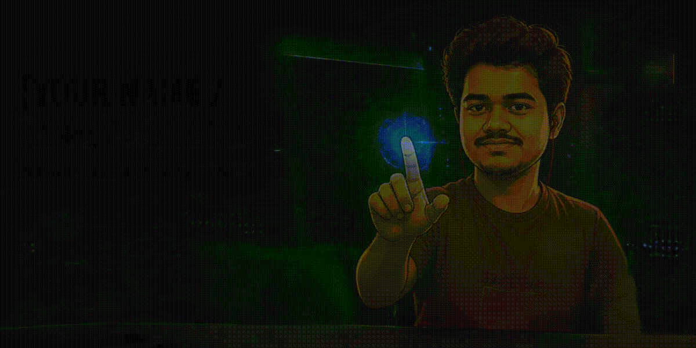

<h1 align="center">Hey, I'm Adwait 👋</h1>

<h3 align="center">AI/ML Engineering Student · Builder of Things That Probably Didn't Need to Exist (But Are Cool)</h3>

  

  

  

  
  

---

## 🧠 About Me

- 🎓 **AI/ML Engineering** student at **Pimpri Chinchwad College of Engineering (PCCoE)**, Pune, Dept. of CSE (AI&ML)
- 🛠️ I build **ML pipelines, RAG apps, and interactive web tools**, usually somewhere between "this is elegant" and "why does this work"
- 🎮 Off-duty: gaming, music, and tinkering with things until they work (or explode nicely)
- ✨ I like my interfaces the way I like my coffee, **dark, neon, and a little dramatic**
- 🔭 Currently exploring: **RAG systems, applied ML, and full-stack development**

---

## ⚡ Tech Stack

  
  
  
  
  
  
  
  
  
  

---

## 🔭 Featured Projects

<table>
  <tr>
    <td width="50%" valign="top">
      <h3>🧪 <a href="https://github.com/adwaitumredkar1818/React-Lab">ReactLab</a></h3>
      
Interactive chemistry explorer for <b>100+ named organic reactions</b>: step-by-step mechanisms, real-time 3D molecules, and a condition simulator.

      <code>JavaScript</code> · <code>Three.js</code>
    </td>
    <td width="50%" valign="top">
      <h3>🏠 <a href="https://github.com/adwaitumredkar1818/Homely">Homely</a></h3>
      
Discovery &amp; booking app for <b>student hostels, tiffin mess subscriptions, and roommate matching</b>, with interactive maps and compatibility tags.

      <code>Web App</code> · <code>Maps</code>
    </td>
  </tr>
  <tr>
    <td width="50%" valign="top">
      <h3>💬 <a href="https://github.com/adwaitumredkar1818/Converse">Converse</a></h3>
      
RAG chat assistant for energy data, powered by a <b>FastAPI + DuckDB</b> backend and a one-of-a-kind "physical scrapbook" interface.

      <code>Python</code> · <code>FastAPI</code> · <code>DuckDB</code> · <code>RAG</code>
    </td>
    <td width="50%" valign="top">
      <h3>📐 <a href="https://github.com/adwaitumredkar1818/Virtual-Lab-LI-LD-">V-Lab (LI-LD)</a></h3>
      
Flask web app that teaches <b>linear algebra</b> concepts interactively, so matrices finally make sense.

      <code>Python</code> · <code>Flask</code>
    </td>
  </tr>
</table>

<i>More in the pinned repos below ⬇️</i>

---

## 📊 GitHub Stats

  
  

  

---

## 🐍 Contribution Snake

  <picture>
    <source media="(prefers-color-scheme: dark)" srcset="https://raw.githubusercontent.com/adwaitumredkar1818/adwaitumredkar1818/output/github-contribution-grid-snake-dark.svg" />
    
  </picture>

---

<i>⚡ Open to collaborating on ML, RAG, and web projects. Say hi!</i>

